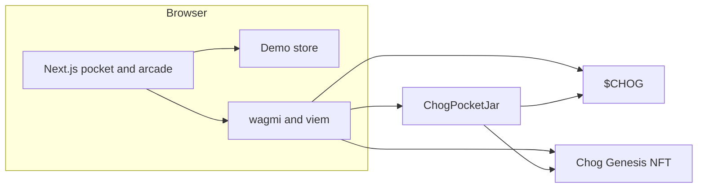

# Architecture

Chog Pocket Pet is a Next.js app on Monad mainnet (chain id 143). Demo mode never leaves the browser. A connected wallet reads $CHOG and Chog Genesis, and the savings jar only moves tokens after those reads and a simulated `feed`.

The pocket UI asks wagmi for the wallet, the $CHOG balance, the Genesis balance, and the allowance. Before `feed` is sent, viem simulates the call. No Genesis balance shows an OpenSea card. A balance under 50 $CHOG shows a buy card. The sample pet, arcade, and leaderboard do not wait on either check.

`feed` on the jar reverts with `NotYourChog` unless `ownerOf(tokenId)` is the caller. `withdraw` only subtracts `pockets[msg.sender].saved` and sends that amount back to the same wallet. Pause blocks new feeds and leaves withdrawals open.

| Piece | Where |
| --- | --- |
| App routes | `src/app` |
| Jar ABI and addresses | `src/lib/abi.ts`, `src/lib/config.ts` |
| Feed gate | `src/lib/feed-gate.ts` |
| Jar source | `contracts/ChogPocketJar.sol` |
| $CHOG | `0x350035555E10d9AfAF1566AaebfCeD5BA6C27777` |
| Chog Genesis | `0xc96d31F8626c6D03Fae5dCD3d61e3FB9F4a73763` |
| Jar | `0xf8Ae354fa05f315B81F2296D541021068CbbECde` |
