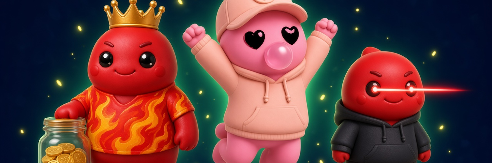

**Your Chog is the pet.** Set $CHOG aside once a day, keep the coins, and let the streak change its mood.

This is not [Chog Pet](https://chogpet.xyz/), the off-chain shared pet. Here the pet is the Chog Genesis picture in your wallet, and the savings sit in a real $CHOG jar on Monad mainnet, next to a six-game arcade.

**Live:** [chog-pocket-pet-teamtitanlink.vercel.app](https://chog-pocket-pet-teamtitanlink.vercel.app)

**Contract:** [ChogPocketJar `0xf8Ae354fa05f315B81F2296D541021068CbbECde`](https://monadscan.com/address/0xf8Ae354fa05f315B81F2296D541021068CbbECde) on Monad mainnet (chain 143). Deploy transaction [`0x1a101535…ec732c`](https://monadscan.com/tx/0x1a101535d455ac9a20970fd643ea6e566140778cd25da1020e5b919210ec732c). Sourcify exact match. $CHOG is [`0x350035555E10d9AfAF1566AaebfCeD5BA6C27777`](https://monadscan.com/token/0x350035555E10d9AfAF1566AaebfCeD5BA6C27777). Chog Genesis is [`0xc96d31F8626c6D03Fae5dCD3d61e3FB9F4a73763`](https://monadscan.com/address/0xc96d31F8626c6D03Fae5dCD3d61e3FB9F4a73763).

## Features

- The pet is the Chog picture. Traits pick the voice. Take the picture away and the pocket is empty.
- A daily set-aside of at least 50 $CHOG. The coins stay yours. A missed day rests the streak.
- Demo mode with four sample Chogs. No wallet.
- A wallet on Monad can feed the deployed jar only when it holds the named Chog Genesis. No Genesis, or not enough $CHOG, stops before any transaction and shows where to go next.
- Six arcade games. A sample Chog can play. A Chog Genesis in the wallet doubles the score that lands on the mood, the streak, and the leaderboard.
- A phone bar (Today, Jar, Arcade, Board, More) and a desktop sidebar.

## Screenshots

| Today | Arcade | Jar |
| --- | --- | --- |
|  |  |  |


## How it works

You open Today and meet a Chog. Feeding is a set-aside: 50, 100, 250, or 1000 $CHOG. The same UTC day does not raise the streak twice. The next day does. A gap starts it again at one. Taking coins back does not wipe the streak.

Demo mode stores that loop on the phone. Connect a wallet and pick a Chog you hold, and the same button reads your Genesis balance, your $CHOG balance, and the jar allowance, then simulates `feed`. The sample pet, the arcade, and the leaderboard keep working when that check stops you.

## Tech stack

Next.js, React, TypeScript, Tailwind, shadcn/ui. Monad through wagmi and viem. The jar is Solidity 0.8.24 with OpenZeppelin (SafeERC20, Ownable2Step, Pausable, ReentrancyGuard). Foundry tests the contract. Playwright clicks through the app. A diagram is in [ARCHITECTURE.md](ARCHITECTURE.md).

## Run locally

```bash
npm install
npm run dev
```

Open http://127.0.0.1:43123. Copy `.env.example` to `.env.local` only if you need to point at a different jar. Do not commit `.env.local`.

## Tests

```bash
npm test
npm run test:e2e
forge test
```

`npm test` is the Vitest suite (streak, savings, traits, arcade physics, and the Genesis / $CHOG feed gate). `npm run test:e2e` is Playwright. `forge test` is the jar: 27 tests, 3 of them fuzzed for 256 runs, with full line coverage on `ChogPocketJar.sol`. There is no GitHub check. Run them on your machine.

## Security

This is an internal review, not a firm sign-off. The write-up is [AUDIT.md](AUDIT.md) and the function list is [CONTRACT.md](CONTRACT.md).

The constructor used to accept a zero token, a zero NFT, or a zero minimum (medium, fixed). Feed used to pull tokens before writing state, checked transfers as bools only, and counted the balance delta (low, fixed with SafeERC20, checks-effects-interactions, and a post-check that the balance rose by at least the amount). The owner can pause new feeds and hand the role over in two steps. The owner cannot move saved $CHOG or pause withdrawals. Slither reported no high or medium issues on the jar. Same-day feeds, wallet-keyed withdrawals, `block.timestamp` days, a standard non-fee $CHOG, and forced ETH are accepted and written down. Do not read this as a claim that the jar is safe beyond that review and the tests.

## Arcade licences

| Game | Upstream | Licence |
| --- | --- | --- |
| Chog Stack | iamkun/tower_game | MIT |
| Chog Tower 3D | KonradLinkowski/Stack | MIT |
| Chog Dash | wayou/t-rex-runner | BSD-3-Clause |
| Floppy Chog | nebez/floppybird | Apache-2.0 |
| Chog 2048 | gabrielecirulli/2048 | MIT |
| Chog Snack Hunt | MattSurabian/DuckHunt-JS | MIT |

Full texts are in `licenses/arcade/`. The pictures in the games were drawn for this pocket. Upstream sprites are not shipped.

The judge walkthrough is in [docs/submission.md](docs/submission.md).

## Building the contracts

Solidity dependencies are not vendored in this public copy. Install them with:

```
forge install OpenZeppelin/openzeppelin-contracts@v5.2.0 foundry-rs/forge-std --no-git
```

Then run `npm install` and `forge test`.
